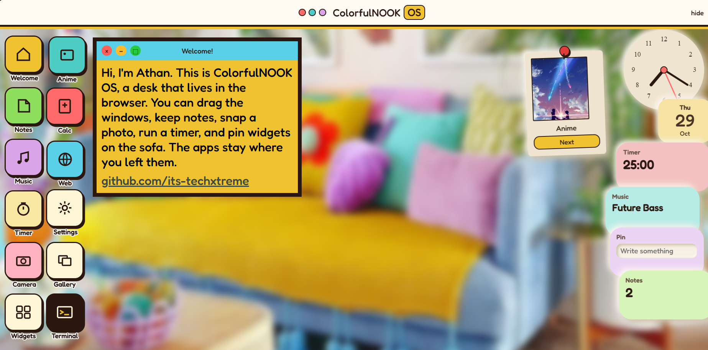
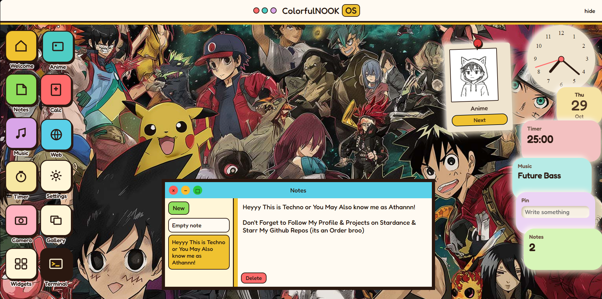

# NookOS V3 (The Successor of Stardance New Start)

Rnnnn its a lightweight, interactive and highly engineered web operating system environment built entirely with vanilla HTML, CSS, and JavaScript onlyy but has a lot of features that even react ones dont have :D. 
This project simulates a desktop interface featuring draggable windows, a Notes app, an ANIME galleryy, a Calculator, a Music app, a Web browserr, a Timer, a Camera, a Gallery, a Terminal, Settings and a pile of Widgets all in a simple modern BROWSER. Wallpaper is the picture The Nook (Nook means like a small corner) of a COlourful room, its reffered as Sofa in the settings, and is the default wallpaper, We also got a COOOOL Anime Wallpaper & plain color wallpapers !!

---

This operating system was made in a Stardance Project :-}
### Stardance Project Link: https://stardance.hackclub.com/projects/64322
### Live Link : https://ColourfulNook-OS.techxtreme.me (Ywah, I like usingg CUSTOM sub-domains)
### In Case DNS sv are Down: https://NookOS-gamma.vercel.app

---

## Some Images of the Project Rnn

Heres the desk on the Sofa wallpaper with Welcome open :-}

And this ones the COOOOL Anime wallpaper with Notes open +_+

---

## Most Key Features Rnnn

* **Window Management:** Fully draggable application windows. Click a window and it comes to the front. You can drag the edges to resize and the title bar doesnt shrink when u do. Top bar stays up top so it doesnt sit on the welcome button anymore. Theres a plain hide on the right of the bar if u want the bar gone for that visit.

* **Welcome:** Just a square window that says hiii & welcomes you to the OS. Its from Athan btw.

* **Notes App:** Hit the + and u get a stickyyy. It still remembers after a refresh. Double click and it asks before deletingg.
Scrapped the old Scratch App.

* **Anime Gallery:** Click one of the total ELEVEN pics and it shows in that same window. The files live in `pics/`.

* **Calculator:** A colored good looking one now. Basic, Sci, Grade and Tip. The keys grow when u resize the window and the window itself changes size when u switch mode. Still shows Infinity & Error along with Calculations.

* **Music App:** Play, Pause, Next, Previous, Shuffle and Loop. Four tracks and Future Bass is the first one. Then Lofi Beat, Vlog Pop, Electro. Open Spotify is right there in the same window. If a local song is playing and u start Spotify, the local one pauses. If Spotify is playing and u hit play here, Spotify pauses. They dont both yell at once.

* **Web Browser:** Address bar starts at webgram.techxtreme.me (My Old NewTab Stardance Project +_+). Hit go and it loads in the window. Also If you forget https it adds it.

* **Timer:** Its not stuck at just 25:00 anymore. U can set hours minutes and seconds. Start, Stop & Reset. When it hits 0 the beep keeps going untill someone actually hits Stop.

* **Clock Widget** Its a rlyy awesome looking minimal Clock widget located on the right. CLick once to open the clock in a window along with a digital time text and the Clock widget disappears when the clock window is open. No clock on the top bar, the widget already does that.

* **Camera:** Open it, pick a filter (Plain Warm Cool Bright Fade Noir), and snap. Theres a 3s and a 10s wait if u want to get in the frame. Shots stay in the roll and gallery.

* **Gallery:** The pics from the camera land here. Crop is a real box u can drag, plus Turn, Undo, Redo, Discard, Save this and Save all r all the options available to feel like a REAAL Gallery App.

* **Terminal:** A little Nook shell u can sayy. Prompt looks like C:\ColorfulNOOK>. Alsoo Type help and it tells u the rest. Its not real Windows terminal obvv, btw I hv tried to Imitate that, btw after all its just the desk.

* **Settings:** Sofa wallpaper stays first and default. Anime is the other COOOL option (PS: if it wasnt based on the Nook Theme this would've been the Default Wallpaper). U can also drop your own pic, change the theme, the text, the font, how the icons sit, and turn on Curvyyy Corners for the APPLE FANBOYSSS.

* **Widgets:** The desk has the anime polaroid, the clock, the date, timer, music, quote, to do and a pin. U can easily Drag them around to change the positioning & Layout. On a phone the pin hides and the quote and to do show up instead so it isnt a mess with so many widgets =_+

* **Phone Optimization:** If the window is narrow the icons go in two columns and the widgets sit on the right, just smaller. The open apps scale down too so theyre not a stretched desktop version alsoo I encountered many bugs while doing this part T_T

---

## Project Architecture

* `index.html` 

* `style.css`

* `script.js` 

* `pics/` the anime shots for Anime gallery app

* `images/` the sofa and anime Wallpapers for Settings app

* `sounds/` the four music tracks for the Music app

---

## Installation & Quick Start

Since this project runs ENTIRELYYY on vanilla HTML, it should require zero external dependencies, compilation steps, or build configurations.

1. Clone or download the repository directory to your local device.

2. Ensure your file directory contains the required asset mappings, Ex: `/pics/1.png`, `/pics/2.png`, `/pics/3.png`, `images/sofa.jpg`, `images/anime.jpg` and the mp3s in `sounds/`.

3. Double-click `index.html` to launch the operating system environment instantly in any modern web browser.

---

# Made By Athannnn :D